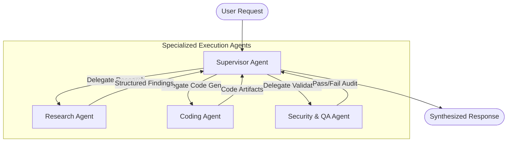
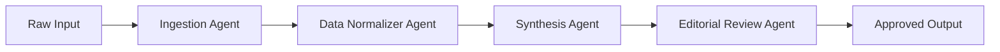

When transitioning beyond single-agent architectures, systems engineers must decide how multiple specialized agents communicate, coordinate, and reach consensus. 

In this architecture guide, we evaluate the three canonical multi-agent topologies: **Hierarchical (Supervisor-Worker)**, **Pipeline (Choreographed)**, and **Decentralized Swarms**.

---

## 1. The Hierarchical (Supervisor-Worker) Topology

In enterprise systems, the Supervisor-Worker pattern is the most robust and predictable pattern. A high-intelligence supervisor model (e.g. Claude 3.7 Sonnet or GPT-4o) decomposes goals, delegates sub-tasks to specialized domain workers, and validates worker deliverables.



### Key Advantages
- **Determinism**: The supervisor enforces the contract before presenting output to users.
- **Segregated Tooling**: Workers only have access to their required tools, minimizing prompt injection attack surfaces.
- **Fail-Fast Recovery**: If the Coding Agent generates flawed code, the QA Agent reports the failure directly to the Supervisor for re-assignment.

---

## 2. The Sequential Pipeline (Assembly Line)

When tasks follow a natural progression, sequential piping maximizes throughput while minimizing orchestrator overhead.



### Implementation Checklist
- Each agent receives the strictly typed output of its predecessor as input.
- Use JSON Schema validation (e.g. Zod or Pydantic) between stages to guarantee that downstream agents never receive malformed inputs.

---

## 3. Managing State: The Event-Sourced Agent Bus

The most dangerous anti-pattern in multi-agent design is allowing multiple agents to mutate a shared global dictionary concurrently. 

Instead, implement an **Event-Sourced Message Bus**:

```typescript
// Architectural schema for Agent Event Bus
interface AgentEvent {
  eventId: string;
  timestamp: number;
  sourceAgent: string;
  targetAgent?: string;
  eventType: "TASK_ASSIGNED" | "TOOL_CALLED" | "OBSERVATION_RECORDED" | "CRITIQUE_SUBMITTED";
  payload: Record<string, any>;
}

class AgentStateCoordinator {
  private events: AgentEvent[] = [];

  public emitEvent(event: AgentEvent): void {
    this.events.push(event);
    console.log(`[EVENT ${event.eventType}] by ${event.sourceAgent}`);
  }

  public getReconstructedState(): Record<string, any> {
    // Replay events deterministically to derive current workspace state
    return this.events.reduce((state, event) => {
      // apply state transitions...
      return state;
    }, {});
  }
}
```

By enforcing event immutability, you obtain full observability, time-travel debugging, and audit logging across all agent steps.
