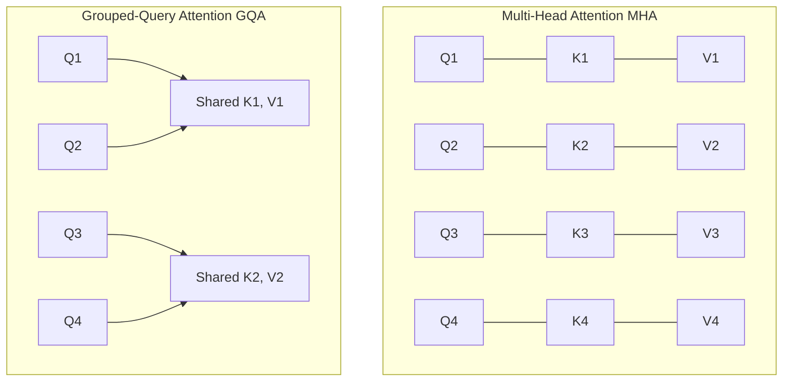
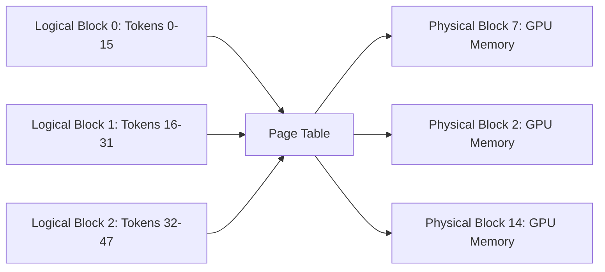

When deploying Large Language Models (LLMs) in production, serving bottlenecks are rarely compute-bound during the generation phase; they are **memory-bandwidth bound**. The primary consumer of GPU VRAM during serving is not just model weights, but the **Key-Value (KV) Cache**.

In this architecture guide, we analyze the mathematics of the KV cache, calculate exact VRAM footprints, and examine how Grouped-Query Attention (GQA) and PagedAttention resolve memory bottlenecks.

---

## 1. Multi-Head Attention vs Grouped-Query Attention (GQA)

In traditional Multi-Head Attention (MHA), each attention head $i \in \{1, \dots, H\}$ projects distinct Query, Key, and Value vectors:

By reducing the number of Key-Value heads $H_{kv}$ to a fraction of the Query heads $H_q$ (e.g., Llama 3 70B uses $H_q = 64$ and $H_{kv} = 8$), the memory footprint of the KV cache drops by an order of magnitude:

$$\text{Compression Factor} = \frac{H_q}{H_{kv}} = \frac{64}{8} = 8\times$$

---

## 2. Calculating KV Cache Memory Footprint

To compute the memory required to store the KV cache for a batch of requests:

$$\text{KV Cache Bytes} = 2 \times 2 \times n_{\text{layers}} \times H_{kv} \times d_{\text{head}} \times \text{seq\_len} \times \text{batch\_size}$$

where:
- First factor $2$: For Keys and Values.
- Second factor $2$: 2 bytes per float16 / bfloat16 element (or 1 byte for FP8).
- $n_{\text{layers}}$: Total transformer layers.
- $H_{kv}$: Number of KV heads.
- $d_{\text{head}}$: Dimension per head ($d_{\text{model}} / H_q$).
- $\text{seq\_len}$: Context window length in tokens.

### Real-World Example: Llama 3 70B

Parameters:
- $n_{\text{layers}} = 80$
- $H_{kv} = 8$
- $d_{\text{head}} = 128$
- Precision: 16-bit (`bfloat16`, 2 bytes)

Memory per token per request:
$$\text{Bytes/token} = 2 \times 2 \times 80 \times 8 \times 128 = 327,680 \text{ bytes} \approx 320 \text{ KB/token}$$

For a sequence length of **32,000 tokens**:
$$\text{Per-request KV Cache} = 32,000 \times 320 \text{ KB} \approx 10.24 \text{ GB VRAM}$$

> [!WARNING]
> Without memory optimization, a single concurrent user generating across a 32k context window consumes over 10 GB of GPU memory just for the KV cache!

---

## 3. PagedAttention: Virtual Memory for LLMs

Standard PyTorch allocations require contiguous memory blocks. Because request generation lengths are unpredictable, naive servers pre-allocate the maximum context length (e.g., 8k or 32k tokens), resulting in:
- **Internal fragmentation**: Up to 60–80% of allocated memory remains unused if queries terminate early.
- **External fragmentation**: Free memory slots scattered across VRAM cannot be merged.

### The Page Table Mechanism

**PagedAttention** (Kwon et al., vLLM) solves this by dividing KV tensors into fixed-size physical blocks (e.g., 16 tokens per block). Non-contiguous physical memory blocks are mapped through a logical page table:

This dynamic allocation pattern reduces memory waste to under 4%, allowing production engines to boost batch sizes and throughput by **2x to 4x**.

---

## 4. FlashAttention-3 and Kernel Fused Reductions

While PagedAttention optimizes memory capacity, **FlashAttention-3** optimizes memory bandwidth speed. By tiling the softmax computation in SRAM without writing intermediate $N \times N$ attention matrices to high-bandwidth memory (HBM), FlashAttention-3 achieves near theoretical hardware peak utilization on NVIDIA Hopper H100 and Blackwell architectures.
