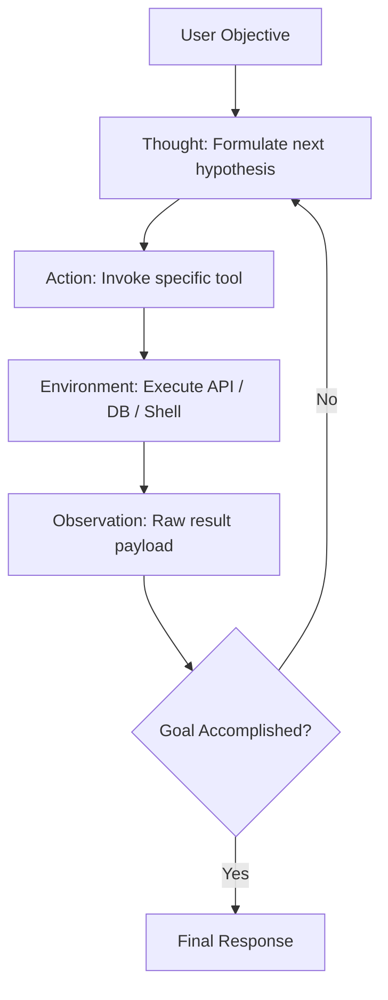
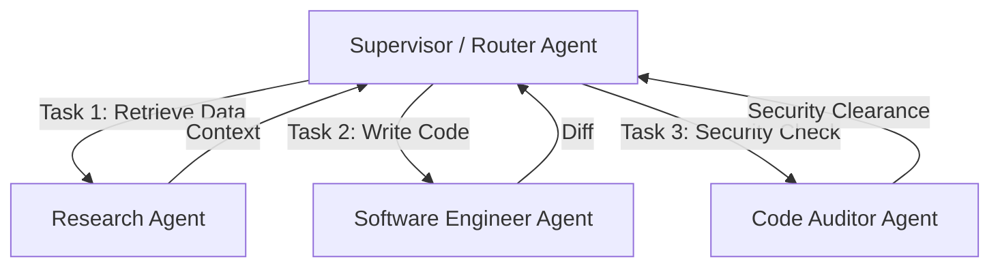

The transition from single-prompt generation to **autonomous agentic workflows** fundamentally shifts how we solve complex computational problems. As Andrew Ng famously observed, agentic workflows with iterative refinement on GPT-3.5 often outperform zero-shot execution on frontier models.

In this deep dive, we formalize the four primary design patterns powering modern AI agents:
1. **Reflection & Self-Correction**
2. **Tool Use & Function Calling**
3. **Decomposition & Planning**
4. **Multi-Agent Collaboration**

---

## 1. The ReAct Pattern (Reasoning + Acting)

Before ReAct (Yao et al., 2022), models either generated freeform thought traces without tools, or took tool actions without articulating their intermediate rationale. ReAct combines both into a synchronized loop:



```
Question: How many days elapsed between the release of Llama 3 and Llama 3.1?

Thought 1: I need to find the exact release date of Meta's Llama 3 model.
Action 1: search_web("Meta Llama 3 release date")
Observation 1: Meta released Llama 3 on April 18, 2024.

Thought 2: Now I need the release date for Llama 3.1.
Action 2: search_web("Meta Llama 3.1 release date")
Observation 2: Meta announced Llama 3.1 with 405B on July 23, 2024.

Thought 3: Now I calculate the days between April 18, 2024 and July 23, 2024.
Action 3: calculate_date_difference(start="2024-04-18", end="2024-07-23")
Observation 3: 96 days.

Thought 4: The answer is clearly 96 days.
Final Answer: Exactly 96 days elapsed between the release of Llama 3 and Llama 3.1.
```

---

## 2. Reflexion: Verbal Reinforcement Learning

The **Reflexion** architecture (Shinn et al., 2023) equips agents with episodic memory and dynamic self-critique without modifying model weights.

When an agent fails a task (e.g., automated test failure or runtime crash), a specialized Evaluator prompts a Self-Reflection model:
- *"What did you do wrong?"*
- *"Why did the plan fail?"*
- *"What specific adjustment should you make in the next trial?"*

```python
# Minimal Reflexion Memory Loop
class ReflexionAgent:
    def __init__(self, task_spec: str):
        self.task_spec = task_spec
        self.reflections = []

    def run_trial(self, trial_number: int):
        prompt = f"""
        Task: {self.task_spec}
        Previous Mistakes & Lessons Learned:
        {chr(10).join(f"- {r}" for r in self.reflections)}
        
        Generate the solution:
        """
        code = llm_generate(prompt)
        passed, error_msg = execute_sandbox_tests(code)
        
        if not passed:
            # Generate critique
            reflection = llm_critique(code, error_msg)
            self.reflections.append(reflection)
            return False
        return True
```

---

## 3. Planning & Dynamic Decomposition

Complex enterprise requests cannot be tackled linearly. Effective agents apply two planning paradigms:

### A. Plan-and-Solve (Static Decomposition)
The planner generates an entire directed acyclic graph (DAG) of sub-steps upfront. Independent sub-steps execute in parallel, and results feed downstream tasks.

### B. Dynamic Replanning (Adaptive Execution)
After each step, the planner observes the state of the workspace and dynamically recalculates the remaining trajectory, pruning obsolete branches.

---

## 4. Multi-Agent Topologies

When building systems with multiple autonomous agents, choosing the right communication topology is critical:

| Topology | Best For | Failure Mode |
| :--- | :--- | :--- |
| **Supervisor-Worker (Hierarchical)** | Clear top-down delegator with specialized workers (e.g. Research, Coder, Reviewer) | Supervisor bottleneck |
| **Sequential (Pipeline)** | Deterministic multi-stage processing (e.g. Scrape $\to$ Summarize $\to$ Translate) | Error propagation down the line |
| **Peer-to-Peer Swarm** | Open-ended exploration and consensus voting | Infinite chatter loops, token explosion |



> [!TIP]
> Always enforce strict turn limits (e.g., maximum 10 turns per agent interaction) and budget token counters to prevent runaway cost loops in multi-agent environments.
