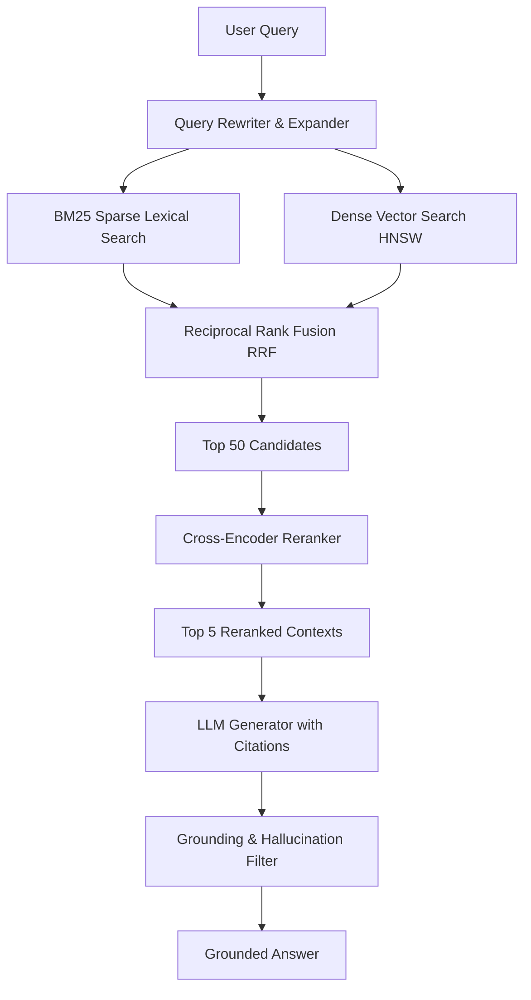

Building a toy Retrieval-Augmented Generation (RAG) prototype with LangChain and an in-memory vector store takes 20 lines of code. However, taking that system into production—where users ask queries spanning thousands of technical manuals, internal wikis, and financial reports—reveals severe failure modes:

1. **The Semantic Drift Problem**: Vector search matches synonyms while ignoring crucial exact codes, error IDs, or dates.
2. **Context Fragmentation**: Splitting text into fixed 512-token chunks shears tables, sentences, and antecedent pronouns from their original context.
3. **Retrieval Clutter**: The LLM context window gets filled with marginally relevant passages that distract the generator.

In this guide, we outline the modern RAG stack engineered to solve these challenges.

---

## The Modern Production Retrieval Architecture



---

## 1. Hybrid Search: BM25 + Dense Embeddings

To achieve high recall across both conceptual queries (*"how do we handle employee travel claims?"*) and token-exact queries (*"error code ERR_4091_FATAL"*), we run parallel sparse and dense retrievers.

### Reciprocal Rank Fusion (RRF) Formula

Instead of attempting to normalize dense cosine similarities $[0, 1]$ and BM25 unbounded scores $[0, \infty)$, we rank candidates by their ordinal position in each list:

$$RRF(d) = \sum_{m \in M} \frac{1}{k + r_m(d)}$$

where:
- $M$ is the set of retrievers (e.g. $\{\text{BM25}, \text{Dense}\}$).
- $r_m(d)$ is the 1-based rank of document $d$ in retriever $m$.
- $k$ is a smoothing parameter, typically set to $60$.

```python
# Production-ready Reciprocal Rank Fusion in Python
from typing import List, Dict

def reciprocal_rank_fusion(
    ranked_lists: List[List[str]], 
    k: int = 60
) -> List[tuple[str, float]]:
    """
    ranked_lists: A list of lists, where each sublist contains document IDs 
                  ordered from highest to lowest rank.
    """
    scores: Dict[str, float] = {}
    
    for r_list in ranked_lists:
        for rank, doc_id in enumerate(r_list, start=1):
            if doc_id not in scores:
                scores[doc_id] = 0.0
            scores[doc_id] += 1.0 / (k + rank)
            
    # Sort descending by fused score
    sorted_docs = sorted(scores.items(), key=lambda item: item[1], reverse=True)
    return sorted_docs
```

---

## 2. Cross-Encoder Rerankers: The Secret Weapon for Precision

Bi-encoder embedding models compute representations of the query and document independently ($E(q) \cdot E(d)$), allowing rapid nearest-neighbor searches in sub-milliseconds. However, bi-encoders miss cross-attention interactions between query tokens and document tokens.

A **Cross-Encoder** (such as `BAAI/bge-reranker-large` or `cohere-rerank-v3`) passes the query and document through attention layers together:

$$\text{Attention}([CLS], q_1, q_2, \dots, [SEP], d_1, d_2, \dots)$$

> [!IMPORTANT]
> Always fetch a wider candidate set from the initial hybrid pass (e.g., $K=50$), and feed them into a cross-encoder to select the final $N=5$ chunks passed to the LLM. This yields up to a 25% jump in NDCG@5 with only 30ms of additional latency.

---

## 3. Anthropic's Contextual Retrieval (Contextual Chunking)

When documents are split into chunks, individual paragraphs often lose vital metadata:

```
[Standard Chunk 3]:
The operating margin increased by 4.2% year-over-year. Revenue was $1.2B.
```
*Which company? Which fiscal year? Which division?*

**Contextual Retrieval** uses a fast, lightweight LLM (such as Gemini 2.0 Flash or Claude 3.5 Haiku) during the indexing pipeline to generate a 50-word context preamble prepended to each chunk:

```
[Contextual Chunk 3]:
<context>
This chunk is from Acme Corp's FY2025 Q3 Form 10-Q filing, discussing the Cloud Infrastructure division financial performance.
</context>
The operating margin increased by 4.2% year-over-year. Revenue was $1.2B.
```

When embedded and stored in BM25 indices, queries like *"Acme 2025 Cloud revenue"* will match this chunk with near 100% precision.

---

## 4. Late Interaction: ColBERT and Modern Vector Engines

For organizations handling millions of documents where cross-encoder latency is prohibitive, **ColBERT (Contextualized Late Interaction over BERT)** offers an optimal balance:

- Token-level multi-vector representations are precomputed for documents.
- At query time, the maximum similarity (MaxSim) operator computes sum-of-maximum inner products:

$$\text{Score}(q, d) = \sum_{i \in q} \max_{j \in d} \left( E(q_i) \cdot E(d_j) \right)$$

Engines like Vespa, Qdrant, and Milvus now provide native multi-vector MaxSim indexing, unlocking sub-15ms late interaction retrieval.

---

## 5. RAG Evaluation with Synthetic Ground Truth

Never deploy a RAG pipeline without measuring two core metrics:

1. **Context Recall**: Are the retrieved passages sufficient to answer the prompt?
2. **Faithfulness**: Is every claim in the generated answer supported by the retrieved context without hallucination?

Tools like Ragas, TruLens, or automated LLM-as-a-judge pipelines should execute on every commit to benchmark vector dimension choices and chunking strategies.
