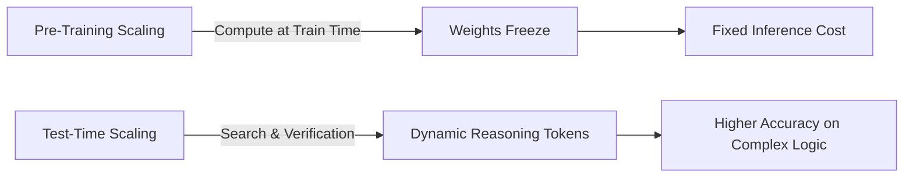

The landscape of generative artificial intelligence underwent a foundational paradigm shift with the realization that **inference-time computation** can scale model performance just as predictably as pre-training FLOPs. Models such as OpenAI's o-series, DeepSeek-R1, and QwQ demonstrate that given sufficient reasoning budget, models can solve complex competitive programming, olympiad mathematics, and multi-step deduction tasks.

In this deep dive, we examine the mechanics of test-time compute, how reinforcement learning with verifiable rewards (RLVR) elicits self-correction, and the engineering tradeoffs between search-based and autoregressive reasoning.

---

## 1. The Scaling Laws of Inference

Traditional scaling laws (Kaplan et al., Chinchilla) dictated that downstream loss is a power-law function of pre-training parameters $N$ and token dataset size $D$:

$$L(N, D) = \left(\frac{N_c}{N}\right)^{\alpha_N} + \left(\frac{D_c}{D}\right)^{\alpha_D}$$

While pre-training scaling continues, data exhaustion and the extreme capital cost of cluster scaling led researchers to investigate the second axis of scaling: **Test-Time Compute**.



When an LLM produces extended "hidden" reasoning tokens (`<think> ... </think>`), it allocates more autoregressive steps to:
1. Break down ambiguous requirements into sub-hypotheses.
2. Backtrack upon detecting contradictions.
3. Validate intermediate results against invariants.

---

## 2. Reinforcement Learning with Verifiable Rewards (RLVR)

The core breakthrough in training reasoning models lies in shifting away from human preference alignment (RLHF) towards **rule-based, verifiable reward environments**. 

In mathematics and competitive programming, ground truth is unambiguous:
- A math answer either matches the numeric solution $y^*$.
- Code either passes automated unit tests in an isolated sandbox or fails with compilation/runtime exceptions.

### Group Relative Policy Optimization (GRPO)

Traditional PPO requires an auxiliary Critic (Value) model that matches the size of the Policy network, doubling GPU VRAM requirements. DeepSeek popularized **Group Relative Policy Optimization (GRPO)**, which eliminates the critic by sampling a group of $G$ candidate outputs $\{o_1, o_2, \dots, o_G\}$ for each query $q$, evaluating the reward $r_i$ for each, and normalizing the advantage across the group:

$$A_i = \frac{r_i - \text{mean}(\{r_1, \dots, r_G\})}{\text{std}(\{r_1, \dots, r_G\}) + \epsilon}$$

The policy loss then updates the actor using clipped probability ratios:

```python
# Conceptual GRPO Advantage Calculation in PyTorch
import torch

def compute_grpo_advantages(rewards: torch.Tensor, eps: float = 1e-8) -> torch.Tensor:
    """
    rewards: shape (batch_size, group_size)
    returns: advantages of shape (batch_size, group_size)
    """
    mean = rewards.mean(dim=-1, keepdim=True)
    std = rewards.std(dim=-1, keepdim=True)
    advantages = (rewards - mean) / (std + eps)
    return advantages
```

> [!NOTE]
> By eliminating the value model, GRPO enables training 70B+ parameter reasoning policies on clusters with substantially lower memory overhead.

---

## 3. The Emergence of Self-Correction and "Aha Moments"

During pure reinforcement learning without supervised demonstration (observed in DeepSeek-R1-Zero), the policy autonomously develops chain-of-thought strategies:
- **Reflective pauses**: Producing phrases like *"Wait, let me recalculate that integral..."* or *"Let's test an edge case where $n=0$."*
- **Length expansion**: Average generation length naturally swells from 500 tokens to 4,000+ tokens as the model searches for valid deduction pathways.

```
<think>
To compute the sum of squares of roots for x^3 - 4x^2 + x + 6 = 0:
By Vieta's formulas:
r1 + r2 + r3 = 4
r1*r2 + r2*r3 + r3*r1 = 1
r1*r2*r3 = -6

We know that (r1 + r2 + r3)^2 = r1^2 + r2^2 + r3^2 + 2(r1*r2 + r2*r3 + r3*r1)
So r1^2 + r2^2 + r3^2 = 4^2 - 2(1) = 16 - 2 = 14.

Wait, let's verify if the polynomial has valid real roots or if that affects the identity.
The identity (a+b+c)^2 holds over any commutative ring regardless of whether roots are real or complex.
Hence 14 is invariant.
</think>
The sum of the squares of the roots is 14.
```

---

## 4. Comparing Approaches: Search vs Autoregressive Chain

| Dimension | Tree-Search (MCTS / Best-of-N) | Autoregressive RL Chain (R1 / o1) |
| :--- | :--- | :--- |
| **Search Mechanism** | External orchestrator samples branches | Model generates single long token chain |
| **Verifier Requirement** | Requires PRM or external simulator | Internalized through RL training |
| **Serving Complexity** | High (multiple state rollouts, caching) | Low (standard autoregressive inference) |
| **Latency** | Proportional to tree depth $\times$ width | Proportional to generated token length |
| **Human Readability** | Disjointed branch evaluations | Continuous conversational narrative |

> [!TIP]
> In production architectures, using an autoregressive reasoning model (e.g., DeepSeek-R1-Distill or o3-mini) for query routing, planning, and code generation produces higher reliability than relying on fragile manual prompt chains.

---

## 5. Architectural Implications for Systems Engineers

1. **Context Window Saturation**: Reasoning models consume 2k–10k tokens before producing a final answer. Fast KV caching (e.g. FlashAttention-3, PagedAttention) is mandatory.
2. **Streaming Protocol**: Frontends must filter or handle `<think>` blocks gracefully, allowing users to collapse or inspect thought traces.
3. **Structured Outputs**: Directing reasoning models to output strict JSON schemas can sometimes constrain reasoning if placed before the `<think>` tags. The optimal pattern is: `<think>` reasoning first, followed by strict JSON output.
