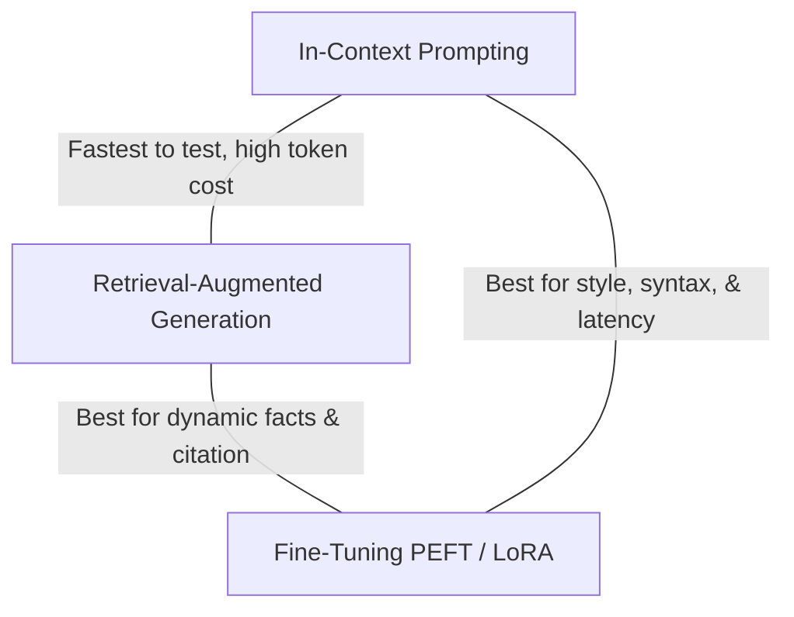

One of the most frequent architectural dilemmas AI teams face is choosing the right method to customize foundation models for internal business needs. Teams frequently make the expensive mistake of fine-tuning a model on company PDFs, only to discover the model hallucinates outdated facts because weights are static.

This guide provides a structured decision framework and an engineering deep-dive into Parameter-Efficient Fine-Tuning (PEFT) using LoRA and QLoRA.

---

## The Strategic Decision Triangle



### The Three Golden Rules

1. **RAG is for Knowledge**: When information changes weekly, requires strict citation, or access control permissions must be enforced per-user, use RAG.
2. **Fine-Tuning is for Behavior**: When you need the model to consistently speak in a specific persona, follow a nuanced 10-step classification taxonomy, or emit valid domain-specific code without verbose instructions, fine-tune.
3. **Prompting is for Exploration**: Always prototype with prompt engineering first. Only graduate to RAG or Fine-Tuning once prompt limitations are empirically documented.

---

## 2. Parameter-Efficient Fine-Tuning (PEFT) with LoRA

When updating dense weight matrices $W_0 \in \mathbb{R}^{d \times k}$, full parameter fine-tuning is computationally prohibitive for 70B+ models.

**LoRA (Low-Rank Adaptation)** hypothesizes that weight updates have a low "intrinsic dimension". It decomposes the update $\Delta W$ into two low-rank matrices $A$ and $B$:

$$W = W_0 + \Delta W = W_0 + \frac{\alpha}{r} (B \cdot A)$$

where:
- $W_0$ is frozen.
- $B \in \mathbb{R}^{d \times r}$ initialized to zero.
- $A \in \mathbb{R}^{r \times k}$ initialized with Gaussian random values.
- $r \ll \min(d, k)$ is the low rank.
- $\alpha$ is a constant scaling hyperparameter.

```python
# Unsloth / PEFT LoRA Configuration Example
from peft import LoraConfig, get_peft_model
from transformers import AutoModelForCausalLM

model = AutoModelForCausalLM.from_pretrained(
    "Qwen/Qwen2.5-Coder-7B-Instruct",
    load_in_4bit=True,
    device_map="auto"
)

lora_config = LoraConfig(
    r=16,
    lora_alpha=32,
    target_modules=["q_proj", "k_proj", "v_proj", "o_proj", "gate_proj", "up_proj", "down_proj"],
    lora_dropout=0.05,
    bias="none",
    task_type="CAUSAL_LM"
)

peft_model = get_peft_model(model, lora_config)
peft_model.print_trainable_parameters()
# Outputs: trainable params: ~20M || all params: ~7.6B || trainable%: 0.26%
```

---

## 3. QLoRA: 4-Bit NormalFloat Quantization

For resource-constrained environments, **QLoRA (Dettmers et al.)** introduced three key innovations enabling fine-tuning a 70B model on a single 48GB GPU:

1. **4-bit NormalFloat (NF4)**: An information-theoretically optimal quantile quantization data type for normally distributed weights.
2. **Double Quantization**: Quantizing the quantization constants themselves, saving an additional 0.37 bits per parameter.
3. **Paged Optimizers**: Leveraging CUDA unified memory to page optimizer states between GPU and CPU RAM during gradient checkpointing spikes.

---

## 4. Summary Matrix

| Attribute | In-Context Prompting | Production RAG | LoRA Fine-Tuning |
| :--- | :--- | :--- | :--- |
| **Setup Time** | Minutes | 1–3 Weeks | 2–4 Weeks |
| **Data Freshness** | Immediate | Real-time | Requires re-training |
| **Inference Cost** | High (large context) | Moderate | Lowest (concise prompts) |
| **Ground Truth Citation**| No | Yes (exact chunks) | No |
| **Format Consistency** | ~85–95% | ~90% | ~99.9% |
| **Specialized Syntax** | Moderate | Poor | Exceptional |

> [!TIP]
> The winning architecture in high-volume enterprise production is often a **hybrid approach**: Fine-tune a compact 8B model to specialize in your tool-calling syntax and query rewriting, and combine it with a hybrid RAG pipeline for retrieval.
