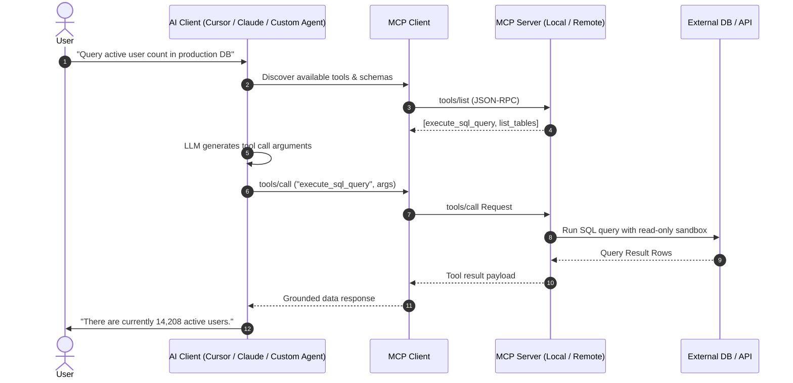

Before late 2024, every LLM framework (LangChain, AutoGen, CrewAI, OpenAI Assistant API) created its own proprietary abstraction for function calling and tool execution. If you wrote an integration to query PostgreSQL, you had to rewrite it for Claude Desktop, rewrite it for Cursor, and rewrite it again for enterprise agents.

**Model Context Protocol (MCP)** solves this fragmentation by establishing an open, standardized client-server protocol. Think of MCP as the **Language Server Protocol (LSP)** for the generative AI era.

---

## MCP Architecture Overview



---

## The Three Core Primitives of MCP

An MCP server exposes three main capabilities to AI clients:

### 1. Tools
Executable actions that an LLM can invoke to perform side effects or computational lookups. Each tool defines:
- A unique `name`.
- A human-readable `description` explaining to the model when to choose this tool.
- A strict `inputSchema` defined in JSON Schema standard.

### 2. Resources
Passive read-only data artifacts that provide context to the model (e.g. file contents, git commit diffs, system logs, documentation pages). Resources are addressed using URIs (e.g., `sqlite://users/schema` or `file:///var/log/syslog`).

### 3. Prompts
Pre-configured prompt templates that guide users and models through standardized workflows (e.g. `debug_stacktrace`, `generate_release_notes`).

---

## Building an MCP Server in TypeScript

Here is a minimal, production-grade MCP server built using the official `@modelcontextprotocol/sdk`:

```typescript
// server.ts
import { Server } from "@modelcontextprotocol/sdk/server/index.js";
import { StdioServerTransport } from "@modelcontextprotocol/sdk/server/stdio.js";
import {
  CallToolRequestSchema,
  ListToolsRequestSchema,
} from "@modelcontextprotocol/sdk/types.js";

// Initialize the MCP Server instance
const server = new Server(
  {
    name: "metrics-mcp-server",
    version: "1.0.0",
  },
  {
    capabilities: {
      tools: {},
    },
  }
);

// Register available tools
server.setRequestHandler(ListToolsRequestSchema, async () => {
  return {
    tools: [
      {
        name: "get_service_latency",
        description: "Fetch P95 and P99 latency metrics for a named backend service.",
        inputSchema: {
          type: "object",
          properties: {
            serviceName: {
              type: "string",
              description: "The name of the microservice (e.g., auth, billing, search)",
            },
            timeWindow: {
              type: "string",
              enum: ["1h", "6h", "24h"],
              description: "Time aggregation window",
            },
          },
          required: ["serviceName"],
        },
      },
    ],
  };
});

// Handle tool execution requests
server.setRequestHandler(CallToolRequestSchema, async (request) => {
  if (request.params.name === "get_service_latency") {
    const { serviceName, timeWindow = "1h" } = request.params.arguments as any;
    
    // Simulate metrics store lookup
    const p95 = Math.floor(Math.random() * 40) + 10;
    const p99 = p95 + 25;
    
    return {
      content: [
        {
          type: "text",
          text: JSON.stringify({
            service: serviceName,
            window: timeWindow,
            p95_ms: p95,
            p99_ms: p99,
            status: "healthy",
          }),
        },
      ],
    };
  }

  throw new Error(`Tool not found: ${request.params.name}`);
});

// Connect over stdio transport
const transport = new StdioServerTransport();
await server.connect(transport);
console.error("Metrics MCP Server running on stdio");
```

---

## Building an MCP Server in Python

For Python environments, the official `mcp` library provides a high-level FastMCP interface:

```python
# server.py
from mcp.server.fastmcp import FastMCP

# Create an MCP server instance
mcp = FastMCP("Database-Tools")

@mcp.tool()
def calculate_churn_rate(active_start: int, churned_count: int) -> dict:
    """Calculates the cohort churn percentage given start active users and cancellations."""
    if active_start <= 0:
        return {"error": "active_start must be positive"}
    
    rate = (churned_count / active_start) * 100.0
    return {
        "active_start": active_start,
        "churned_count": churned_count,
        "churn_rate_pct": round(rate, 2),
        "retention_rate_pct": round(100.0 - rate, 2)
    }

if __name__ == "__main__":
    mcp.run()
```

---

## Security Boundaries & Best Practices

> [!CAUTION]
> Never connect an LLM client to an MCP server that executes arbitrary shell or unparameterized SQL queries against production infrastructure without strict authentication and human-in-the-loop confirmation.

Key security controls for MCP in production:
1. **Read-Only Encasement**: Always default database MCP servers to read-only replica credentials.
2. **Deterministic Argument Validation**: Validate all inputs using Zod or Pydantic before routing to system subprocesses.
3. **Audit Logging**: Log every `tools/call` invocation with model metadata and execution timestamps.
