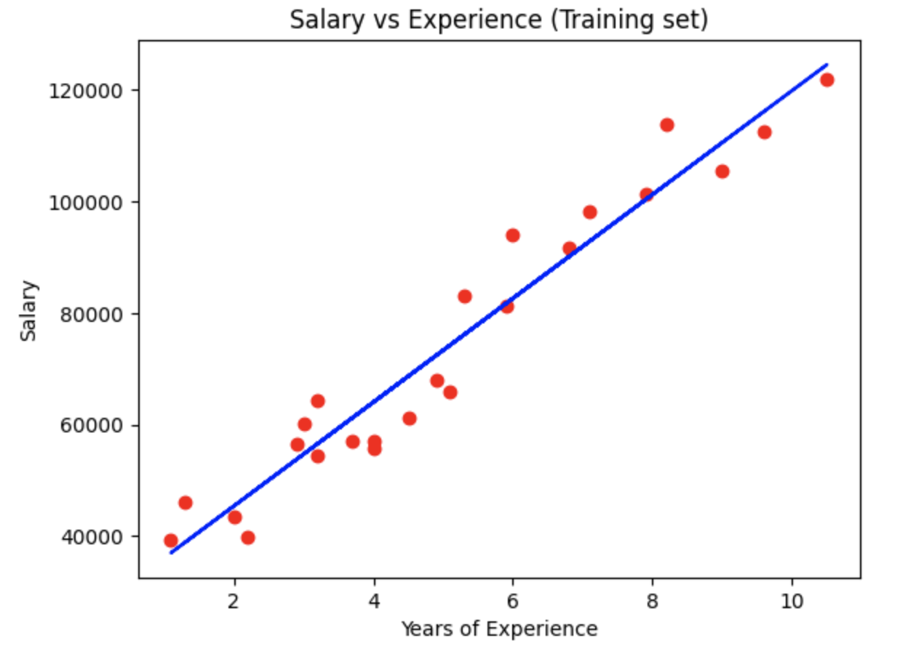
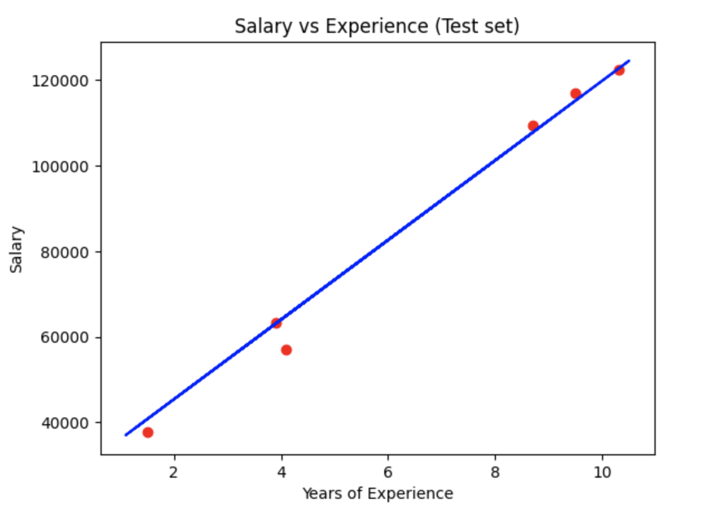
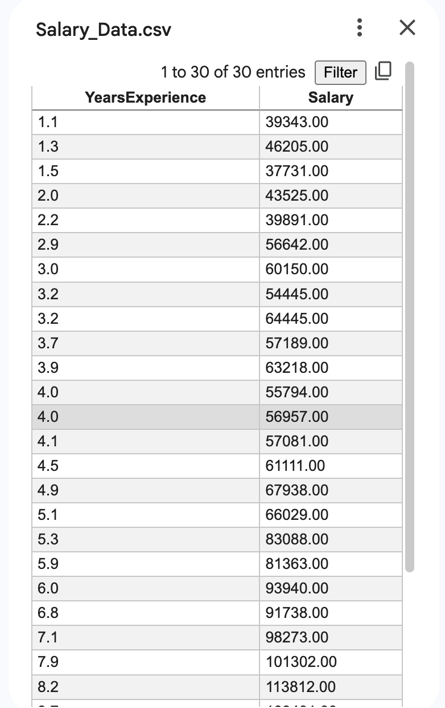

Simple Linear Regression is a foundational statistical and machine learning method used to model the linear relationship between a single independent (predictor) variable X and a continuous dependent (target) variable Y.

Ordinary least squares --> ŷ  = b₀ + b₁ X

ŷ (y-hat): Predicted value of the dependent variable X
b₀ (Intercept): The predicted value of y when X = 0.
b₁(Slope): The change in ŷ for a one-unit increase in X

```typescript
//Importing the libraries
import numpy as np
import matplotlib.pyplot as plt
import pandas as pd


//Importing the dataset
dataset = pd.read_csv('Salary_Data.csv')
X = dataset.iloc[:, :-1].values
y = dataset.iloc[:, -1].values


//Splitting the dataset into the Training set and Test set
from sklearn.model_selection import train_test_split
X_train, X_test, y_train, y_test = train_test_split(X, y, test_size = 0.2, random_state = 0)


//Training the Simple Linear Regression model on the Training set
from sklearn.linear_model import LinearRegression
regressor = LinearRegression()
regressor.fit(X_train, y_train)


//Predicting the Test set results
y_pred = regressor.predict(X_test)


//Visualising the Training set results
plt.scatter(X_train, y_train, color = 'red')
plt.plot(X_train, regressor.predict(X_train), color = 'blue')
plt.title('Salary vs Experience (Training set)')
plt.xlabel('Years of Experience')
plt.ylabel('Salary')
plt.show()


//Visualising the Training set results
plt.scatter(X_train, y_train, color = 'red')
plt.plot(X_train, regressor.predict(X_train), color = 'blue')
plt.title('Salary vs Experience (Training set)')
plt.xlabel('Years of Experience')
plt.ylabel('Salary')
plt.show()


//Visualising the Test set results
plt.scatter(X_test, y_test, color = 'red')
plt.plot(X_train, regressor.predict(X_train), color = 'blue')
plt.title('Salary vs Experience (Test set)')
plt.xlabel('Years of Experience')
plt.ylabel('Salary')
plt.show()

```






