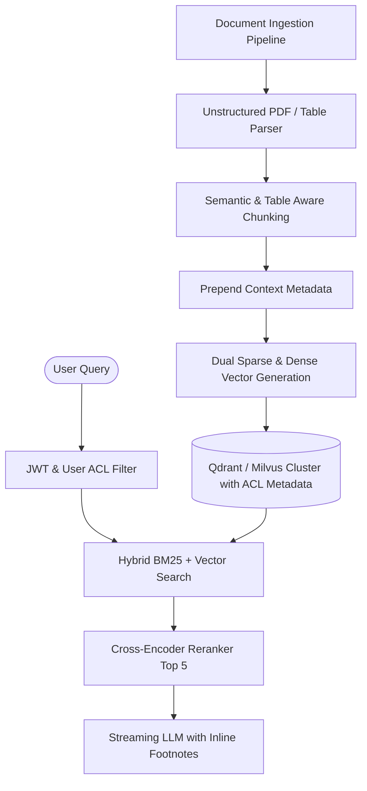
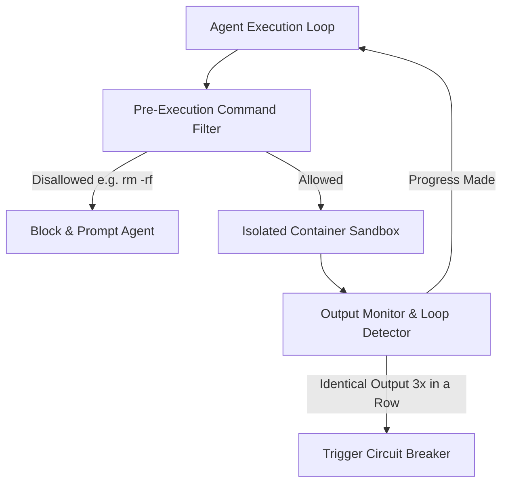

Preparing for an **AI Systems Architect** or **Senior AI Engineer** interview requires demonstrating a firm grasp of distributed systems, vector retrieval, GPU inference economics, and agentic control flow. 

Below are high-frequency system design scenarios and reference solutions.

---

## Scenario 1: Design a Production RAG System for 20 Million Financial Documents

### Interviewer Prompt
*"Design a search and question-answering system over 20 million regulatory filings, financial statements, and analyst reports. The system must guarantee citation fidelity, achieve sub-second response times, and support user-specific access control lists (ACLs)."*

### Key Talking Points to Hit
1. **Document Ingestion & Chunking**: Do not use naive 500-character chunking. Mention table preservation (converting HTML/Markdown tables) and Anthropic-style Contextual Retrieval to prepend company/quarter metadata.
2. **Access Control Filtering**: Explain why metadata filtering (pre-filtering by `org_id` and `user_role` in the vector DB payload) is safer than post-filtering after ANN search.
3. **Latency Optimization**: Use an ANN index like HNSW with quantized vectors (scalar quantization SQ8 or product quantization PQ) for fast candidate retrieval, then rerank with a cross-encoder model.

---

## Scenario 2: Prevent Multi-Turn Autonomous Agents from Runaway Looping

### Interviewer Prompt
*"You deploy an autonomous coding agent with shell execution and git tools. How do you detect and recover from infinite loops, hallucinated dependencies, or destructive commands?"*

### Solution Architecture
1. **Episodic Loop Detection**: Compute a rolling hash of the last 3 `(Thought, Action, Output)` tuples. If a loop is detected, inject a hard intervention prompt: *"You are repeating the same failed command. Cease this approach and try an alternative."*
2. **Container Sandboxing**: Run tool executions inside ephemeral Docker or gVisor microVMs with disabled internet access except for explicit package mirrors.
3. **Budget Caps**: Enforce strict per-session token budgets and max-step timeouts ($N=15$).

---

## Scenario 3: Memory Sizing for High-Concurrency LLM Inference

### Interviewer Prompt
*"How would you calculate whether a cluster of 8x H100 GPUs (80GB each) can serve a 70B parameter model with a 32k context window at 100 concurrent requests?"*

### Calculation Steps
1. **Model Weights**: A 70B model in 16-bit (`bfloat16`) requires $70 \times 2 = 140\text{ GB}$ of VRAM.
2. **KV Cache per Token**: With GQA ($H_{kv} = 8$, $d=128$, 80 layers), memory per token is $2 \times 2 \times 80 \times 8 \times 128 \approx 320\text{ KB/token}$.
3. **KV Cache for 32k context**: $32,000 \times 320\text{ KB} \approx 10.24\text{ GB}$ per request.
4. **Total for 100 concurrent requests**: $100 \times 10.24\text{ GB} = 1,024\text{ GB}$.
5. **Total VRAM required**: $140\text{ GB} + 1,024\text{ GB} = 1,164\text{ GB}$.
6. **Total Available VRAM**: $8 \times 80\text{ GB} = 640\text{ GB}$.

**Conclusion**: The cluster **cannot** handle 100 concurrent full 32k requests in FP16 ($1,164\text{ GB} > 640\text{ GB}$). 

**Optimization Strategies**:
- Quantize KV cache to FP8 (slashes KV cache from $1,024\text{ GB}$ to $512\text{ GB}$).
- Use PagedAttention and chunked prefill to maximize GPU utilization.
- Add Tensor Parallelism (TP=8) across the 8 GPUs to distribute model weights evenly ($17.5\text{ GB}$ weights per GPU).
