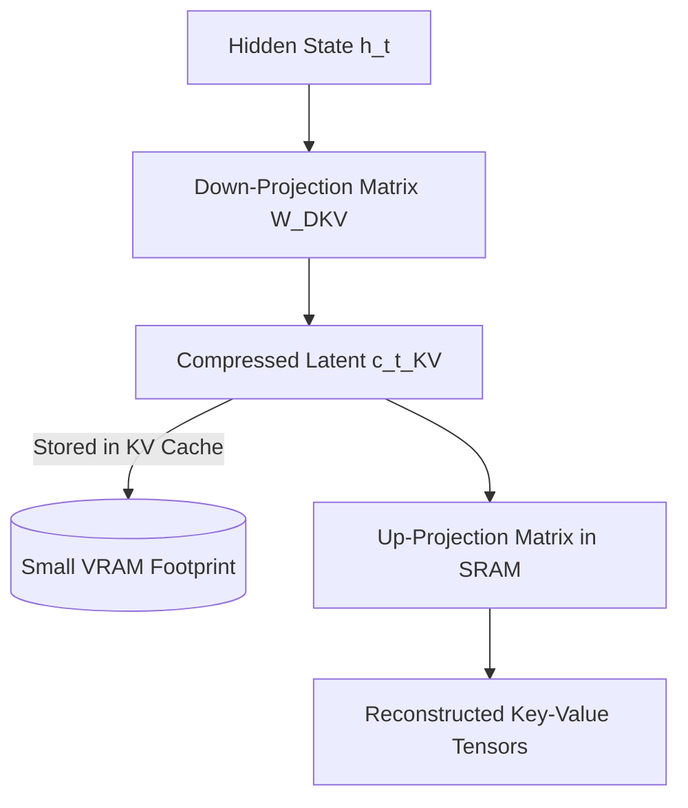
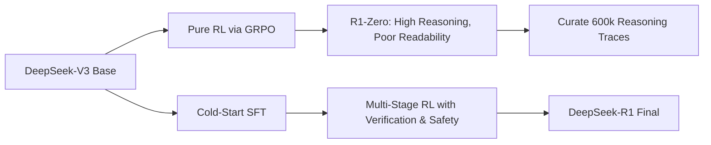

DeepSeek-R1 represents one of the most impactful open-weights model releases in AI history, proving that competitive mathematical and reasoning capabilities can be unlocked through reinforcement learning with verifiable rewards (RLVR) rather than relying exclusively on massive human demonstration datasets.

---

## 1. Architectural Innovations in the Base Model

The foundation of DeepSeek-R1 is DeepSeek-V3, which introduces two pivotal hardware-aware innovations:

### A. Multi-Head Latent Attention (MLA)
Standard Multi-Head Attention stores full dimension vectors for every key and value token in the KV cache. MLA projects keys and values into a shared compressed latent vector $c_t^{KV} \in \mathbb{R}^{d_c}$:

$$c_t^{KV} = W^{DKV} h_t$$

During generation, keys and values are decompressed on-the-fly inside SRAM, reducing GPU memory traffic dramatically:
- **KV cache per token**: Reduced from ~320 KB to ~22 KB for a 671B MoE model!

### B. DeepSeekMoE Architecture
- Total Parameters: 671B
- Active Parameters per token: 37B
- Fine-grained experts: 256 routed experts + 1 shared expert. Each token activates 8 routed experts, allowing specialization without sacrificing common knowledge.

---

## 2. From R1-Zero to R1: The Training Recipe

1. **Phase 1: R1-Zero (Pure RL)**: Trained directly on the base model with Group Relative Policy Optimization (GRPO) using only accuracy rewards (compiler / math verifier) and formatting rewards. The model spontaneously acquired reasoning behaviors, self-verification, and extended chain-of-thought.
2. **Phase 2: Cold-Start SFT**: To fix language mixing and illegible formatting observed in R1-Zero, thousands of clean, readable chain-of-thought examples were curated.
3. **Phase 3: Reasoning RL**: Reinforcement learning was applied to the SFT model, adding reward models for human readability and alignment alongside rule-based verifiers.

---

## 3. Distillation into Dense Architectures

Rather than requiring teams to self-host 671B parameter clusters, DeepSeek open-sourced distilled models:
- `DeepSeek-R1-Distill-Qwen-1.5B`
- `DeepSeek-R1-Distill-Qwen-7B`
- `DeepSeek-R1-Distill-Qwen-14B`
- `DeepSeek-R1-Distill-Qwen-32B`
- `DeepSeek-R1-Distill-Llama-70B`

These models achieve state-of-the-art reasoning scores (e.g., 32B model scoring >94% on MATH-500) while running locally on consumer hardware.
