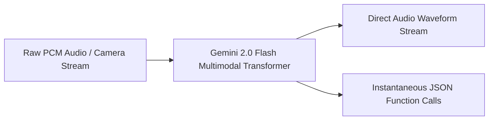

With the release of Gemini 2.0 Flash, the focus of foundation model development expanded from purely text-based reasoning towards **real-time, bidirectional multimodal agent systems**.

In this release review, we examine the system architecture, latency profiles, and developer API patterns of Gemini 2.0 Flash.

---

## 1. Sub-200ms Bidirectional Streaming

Traditional voice assistants use a cascaded pipeline:
$$\text{Audio Input} \xrightarrow{\text{ASR}} \text{Text} \xrightarrow{\text{LLM}} \text{Text} \xrightarrow{\text{TTS}} \text{Audio Output}$$

Each stage introduces 300–700ms of latency, resulting in an unnatural 1.5 to 2.5-second roundtrip pause.

Gemini 2.0 Flash is a **native speech-to-speech and vision-to-speech model**:



- **Latency**: End-to-end audio response in ~250ms.
- **Interruption Handling**: The client can send inbound audio frames mid-generation; the model naturally halts speech upon detecting human voice.

---

## 2. Low-Latency Tool Calling for Autonomous Agents

Gemini 2.0 Flash provides exceptional speed for autonomous agent execution loops:
- Time-to-first-token (TTFT): Under 150ms on cloud infrastructure.
- High tool-call accuracy across complex multi-turn nested JSON schemas.
- Deep native grounding integration with Google Search and code execution sandboxes.

```python
# Using Google GenAI SDK for Streaming Multimodal Tool Calls
from google import genai
from google.genai import types

client = genai.Client()

def check_inventory(sku: str) -> dict:
    return {"sku": sku, "in_stock": True, "warehouse_location": "B-42"}

response = client.models.generate_content(
    model="gemini-2.0-flash",
    contents="Is product SKU-9942 available in our warehouse?",
    config=types.GenerateContentConfig(
        tools=[check_inventory],
        temperature=0.0
    )
)

print("Tool Call Decision:", response.function_calls)
```

---

## 3. Comparison with Frontier Reasoning Engines

| Capability | Gemini 2.0 Flash | DeepSeek-R1 | Claude 3.7 Sonnet |
| :--- | :--- | :--- | :--- |
| **Primary Strength** | Real-time multimodal streaming & fast agent tools | Deep math & programming reasoning chains | Hybrid reasoning & extended code architecture |
| **Input Modalities** | Text, Audio, Video, Image, PDF | Text | Text, Image, PDF |
| **Median TTFT** | ~140ms | ~1,200ms (thinking tokens) | ~400ms |
| **Cost per 1M Input Tokens** | \$0.10 | \$0.55 | \$3.00 |

> [!TIP]
> A common architecture in 2026 systems is using **Gemini 2.0 Flash** as the ultra-fast real-time sensory layer, input classifier, and conversational frontend, while routing high-complexity reasoning tasks to **DeepSeek-R1** or **Claude** in the background.
