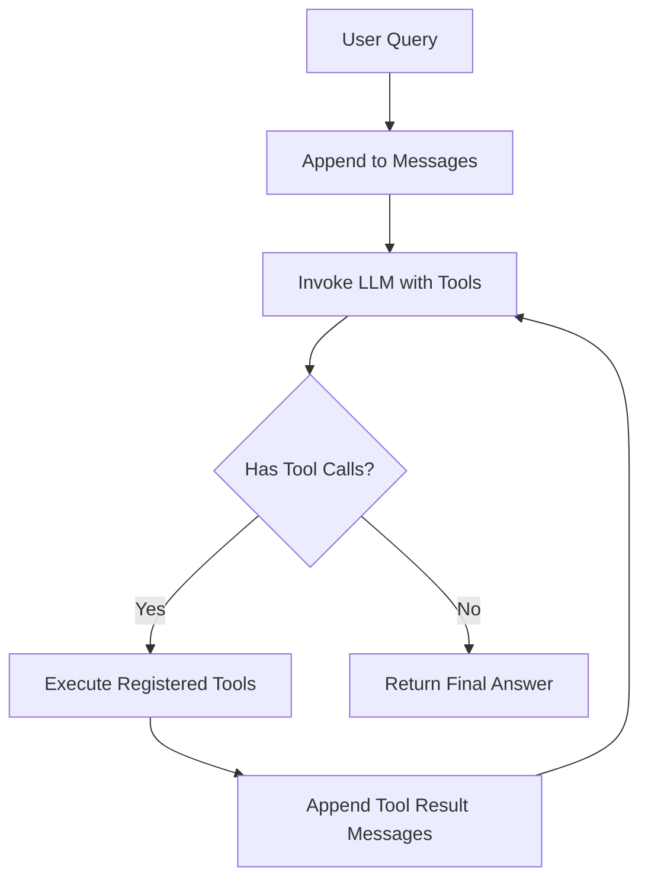

Welcome to the **AI Learnings** developer tutorial. In this guide, we will build a production-grade autonomous agent from scratch in Python using vanilla standard libraries and the OpenAI / Anthropic client SDK.

No complex wrapper frameworks. Just clean, observable, maintainable Python code.

---

## 1. Architecture of the Agent Loop

An autonomous agent consists of three essential components:
1. **Tool Registry**: A dictionary mapping tool names to executable functions and their JSON schemas.
2. **Context Memory**: A structured message history holding user inputs, assistant thoughts, tool call IDs, and tool execution outputs.
3. **Execution Loop**: A while loop that evaluates model outputs, executes requested tools, appends observations, and re-invokes the model until completion.



---

## 2. Step 1: Defining the Tool Registry

We define our tools with python type hints and JSON Schema definitions:

```python
import json
import math
from typing import Any, Callable, Dict, List

# Tool implementations
def calculate_expression(expression: str) -> str:
    """Safely evaluates a basic mathematical expression."""
    allowed_names = {"math": math, "sqrt": math.sqrt, "pow": math.pow}
    try:
        result = eval(expression, {"__builtins__": None}, allowed_names)
        return str(result)
    except Exception as e:
        return f"Error evaluating expression: {str(e)}"

def get_server_health(region: str) -> str:
    """Mock API returning latency and status for a cloud region."""
    regions = {
        "us-east": {"status": "operational", "latency_ms": 22},
        "eu-west": {"status": "degraded", "latency_ms": 145},
        "ap-south": {"status": "operational", "latency_ms": 38},
    }
    return json.dumps(regions.get(region.lower(), {"status": "unknown"}))

# Tool Schema definitions for LLM
TOOLS = [
    {
        "type": "function",
        "function": {
            "name": "calculate_expression",
            "description": "Evaluate a mathematical expression. E.g. 'sqrt(144) + 15'",
            "parameters": {
                "type": "object",
                "properties": {
                    "expression": {"type": "string", "description": "The math expression to calculate"}
                },
                "required": ["expression"]
            }
        }
    },
    {
        "type": "function",
        "function": {
            "name": "get_server_health",
            "description": "Fetch current status and latency for a cloud region",
            "parameters": {
                "type": "object",
                "properties": {
                    "region": {"type": "string", "enum": ["us-east", "eu-west", "ap-south"]}
                },
                "required": ["region"]
            }
        }
    }
]

TOOL_MAP: Dict[str, Callable] = {
    "calculate_expression": calculate_expression,
    "get_server_health": get_server_health
}
```

---

## 3. Step 2: Implementing the Autonomous Loop

```python
from openai import OpenAI

client = OpenAI()

def run_agent(user_query: str, max_iterations: int = 10) -> str:
    messages: List[Dict[str, Any]] = [
        {
            "role": "system",
            "content": "You are an autonomous engineering assistant. Use provided tools when needed. Explain your thought process concisely."
        },
        {"role": "user", "content": user_query}
    ]

    iteration = 0
    while iteration < max_iterations:
        iteration += 1
        print(f"--- Iteration {iteration} ---")

        response = client.chat.completions.create(
            model="gpt-4o",
            messages=messages,
            tools=TOOLS,
            tool_choice="auto"
        )

        message = response.choices[0].message
        messages.append(message)

        # Check if model wants to call tools
        if not message.tool_calls:
            print("Goal achieved. Returning final answer.")
            return message.content or ""

        # Execute each tool call
        for tool_call in message.tool_calls:
            func_name = tool_call.function.name
            func_args = json.loads(tool_call.function.arguments)
            tool_call_id = tool_call.id

            print(f"Executing Tool: {func_name} with args: {func_args}")
            
            tool_fn = TOOL_MAP.get(func_name)
            if tool_fn:
                try:
                    tool_output = tool_fn(**func_args)
                except Exception as err:
                    tool_output = f"Execution error: {err}"
            else:
                tool_output = f"Error: Tool '{func_name}' not found."

            # Append tool result to context
            messages.append({
                "role": "tool",
                "tool_call_id": tool_call_id,
                "content": str(tool_output)
            })

    return "Agent terminated: maximum iterations reached without resolution."
```

---

## 4. Testing the Agent

```python
if __name__ == "__main__":
    result = run_agent("Check the health of eu-west, and if latency is above 100ms, compute latency multiplied by 1.25.")
    print("\nResult:\n", result)
```

> [!NOTE]
> Notice how the agent automatically decomposes the query: first calls `get_server_health(region="eu-west")`, observes `latency_ms: 145`, identifies that $145 > 100$, and then invokes `calculate_expression(expression="145 * 1.25")`.

---

## 5. Production Considerations

1. **Timeout Guardrails**: Always enforce per-tool timeouts using `concurrent.futures` or `asyncio.wait_for`.
2. **Deterministic Argument Parsing**: Use Pydantic models to validate arguments before passing them into critical business systems.
3. **Token Budgets**: Prune or summarize historical tool outputs if total token consumption approaches 80% of model context limits.
